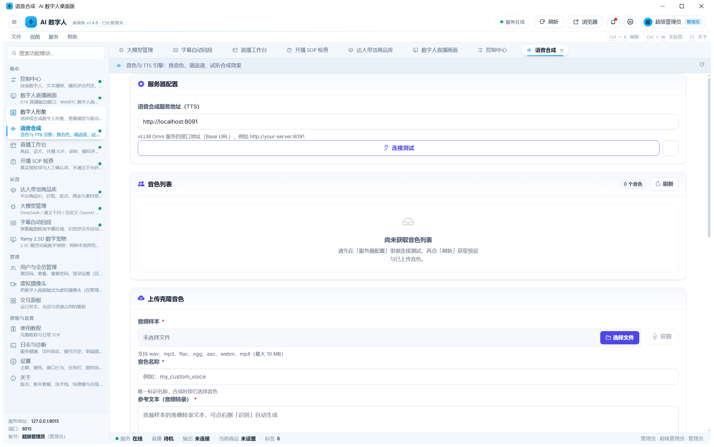
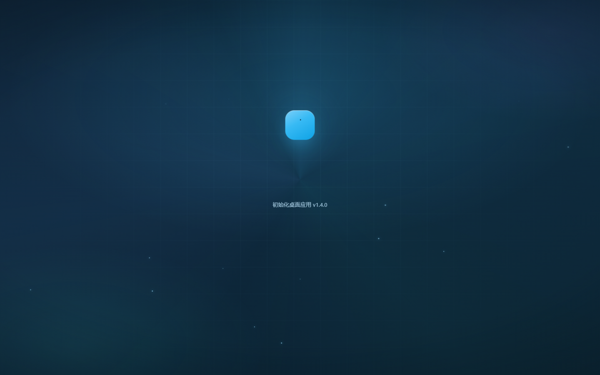
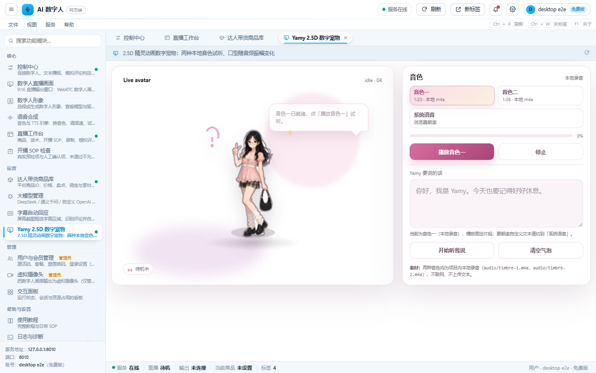
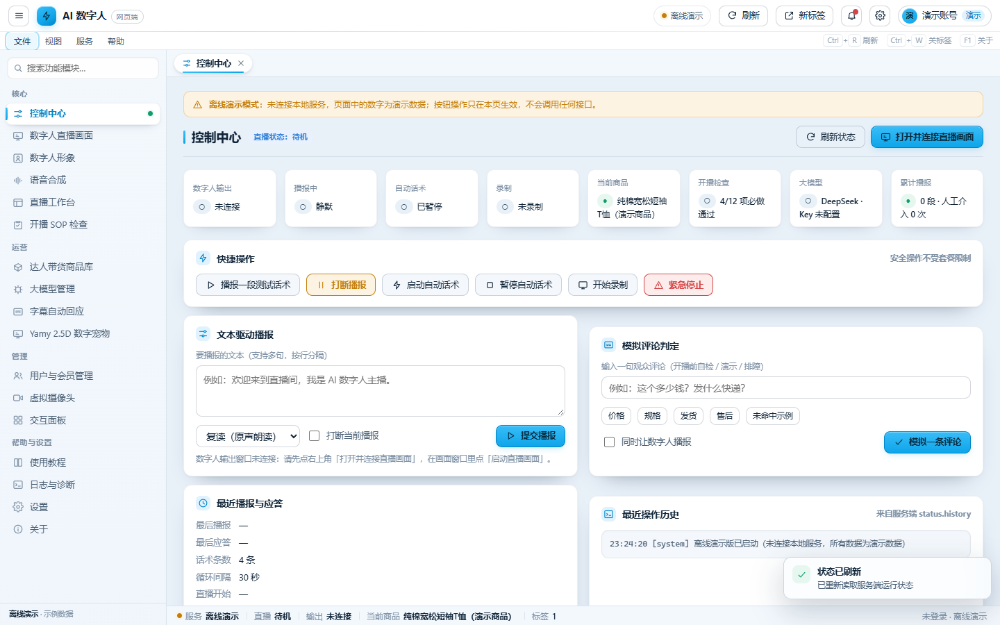

# AI 数字人桌面端 · AiLive-Desktop

> 把开源实时数字人引擎 **LiveTalking** 包成一个开箱即用的 Windows 桌面程序：
> 独立 `AILiveDesktop.exe`、原生窗口与任务栏图标、**自己托管后端服务**、带安装包与卸载。

<p>
  
  
  
  
  <a href="https://github.com/lipku/LiveTalking"></a>
</p>



---

## 目录

- [一、这是什么](#一这是什么)
- [二、功能一览](#二功能一览)
- [三、架构](#三架构)
- [四、目录结构](#四目录结构)
- [五、快速开始](#五快速开始)
- [六、桌面端 vs 网页端](#六桌面端-vs-网页端)
- [七、自检与验收](#七自检与验收)
- [八、配置与密钥](#八配置与密钥)
- [九、已知约束与踩过的坑](#九已知约束与踩过的坑)
- [十、文档索引](#十文档索引)
- [十一、许可与致谢](#十一许可与致谢)

---

## 一、这是什么

一个**真正的 Windows 桌面应用**，不是"把网页放进浏览器标签页"。界面内部用 WebView2（Chromium 内核）渲染
——这是 VS Code、Teams、飞书桌面版走的同一条路——所以"真桌面"指的是下面这些可验证的硬指标：

| 硬指标 | 本项目实现 |
| --- | --- |
| 独立可执行程序 | `AILiveDesktop.exe`（PyInstaller onedir，带图标与版本资源） |
| 独立进程 + 原生窗口 | 进程名 `AILiveDesktop`，Win32 顶层窗口标题「AI 数字人桌面版」 |
| 后端由应用自己托管 | 启动时检测 8010：没有就自己拉起 LiveTalking，退出时只停掉自己拉起的那一个 |
| 安装包 / 卸载 | 桌面 + 开始菜单快捷方式、HKCU 卸载项（控制面板可卸载），**不需要管理员权限** |
| 单实例、可持久化 | 8011 端口单实例锁；WebView2 用户目录持久化登录态与窗口设置 |
| 自己实现的全屏 | 无边框 + 精确铺满显示器物理像素 + 全屏期间让任务栏让位（含崩溃自恢复） |
| 崩溃不留僵尸 | 退出看门狗：界面请求退出后主循环若未结束，兜底结束进程并（必要时）停服务 |

**诚实的边界**：界面仍然是 HTML/CSS/JS，渲染依赖系统 WebView2 运行时（Win10 1803+ / Win11 自带；
缺失时应用会提示并给出安装指引）。



## 二、功能一览

应用外壳是「左导航 + 顶部工具栏 + 多标签页 + 底部状态栏」，共 **17 个模块 / 4 个分组**：

| 分组 | 模块 |
| --- | --- |
| 核心 | 控制中心（原生）、数字人直播画面、直播工作台、开播 SOP 检查（原生）、数字人形象、语音合成 |
| 运营 | 达人带货商品库、大模型管理、字幕自动回应、Yamy 2.5D 数字宠物 |
| 管理 | 用户与会员管理、虚拟摄像头、交互面板 |
| 帮助 | 使用教程、日志与诊断（原生）、设置（原生）、关于（原生） |

底层能力来自 LiveTalking 与配套服务：

- **实时数字人**：Wav2Lip / MuseTalk / ERNERF / Ultralight，WebRTC 低延迟推流
- **语音**：Edge TTS 及多种引擎、**声音克隆**（上传/录音 → 注册音色 → 生成）
- **大模型**：DeepSeek / 通义千问 / 任意 OpenAI 兼容接口，用于自动话术与评论回应
- **直播运营**：商品库、话术 SOP、录制、模拟评论判定、虚拟摄像头输出
- **账号体系**：登录 / 注册 / 会员套餐 / 权限判定，权限由**服务端**判定，外壳不替服务端放行



还有一个**离线演示副本**：`desktop/AI数字人桌面界面（离线演示）.html` 双击即开，
不调用任何接口、数据全部标注"演示"，用来在没有环境时看界面。



## 三、架构

```
AILiveDesktop.exe                      ← 桌面宿主（pywebview + WebView2）
├── app/app.py                          单实例 / 服务托管 / 启动状态机 / 桌面桥接 API / 退出看门狗
├── app/ui_server.py                    本地界面源：127.0.0.1:8015~8020 提供自带界面 + 反向代理
├── app/desktop_window.py               原生窗口：自实现全屏（铺满屏幕 + 任务栏让位）
├── app/splash.html                     启动页（真实进度 + 失败诊断与按钮）
└── 托管 ↓
    LiveTalking/app.py                  ← 数字人引擎（Flask + aiortc，127.0.0.1:8010）
    ├── server/routes.py                 页面路由 + API
    ├── server/auth_manager.py           账号 / 会员 / 会话
    ├── tts/                             TTS 引擎与音色
    ├── streamout/                       WebRTC / RTMP / RTCPush / 虚拟摄像头
    └── web/                             界面源码（app.html 为应用外壳本体）
```

**界面同源方案**：桌面端不加载 8010 的网页端页面，而是渲染随包固化的副本（`app/ui/`，由
`app/vendor_ui.py` 从 `LiveTalking/web` 生成），由 `ui_server.py` 在同源下提供，并把 `/api/*`、
`/offer`、`/record/*`、WebSocket 反向代理给 8010 —— 一行界面代码都不用改，登录态、相对路径、
iframe、`EventSource`、WebRTC 全部照旧可用。

> 本仓库**不含** `app/ui/`（生成物）。首次使用前执行一次固化：
> `python app/vendor_ui.py`（`app/build_exe.ps1` 打包时会自动做）。

## 四、目录结构

```
├── app/                     桌面宿主（PyInstaller 打包目标）
│   ├── app.py               宿主主程序
│   ├── ui_server.py         本地界面源 + 反向代理
│   ├── desktop_window.py    原生窗口 / 自实现全屏
│   ├── vendor_ui.py         固化界面副本 web/ → app/ui/
│   ├── splash.html          启动页
│   ├── build_exe.ps1        一键打包
│   └── installer/           安装 / 卸载 / 自检脚本
├── LiveTalking/             数字人引擎（LiveTalking 的本地定制分支，Apache-2.0）
│   ├── app.py               引擎入口
│   ├── server/              路由、鉴权、会话
│   ├── tts/  streamout/  utils/
│   └── web/                 界面源码（app.html = 应用外壳）
├── desktop/                 离线演示副本（file:// 直接打开）
├── docs/                    使用与维护文档 + 截图
├── tools/                   启动 / 停止 / 打包 / 预热脚本
│   └── smoke/               自检与端到端验收脚本
├── yamy_25d/                2.5D 数字宠物页面
├── 一键启动AI数字人.cmd      ← 启动服务（双击）
├── 桌面版AI数字人.cmd        ← 启动桌面端（双击）
└── 使用说明.txt             用户向操作手册
```

## 五、快速开始

**环境要求**：Windows 10 1803+ / 11、WebView2 运行时、Python 3.10+（推荐 Miniconda）、
可选 NVIDIA GPU（纯 CPU 也能跑，帧率低）

### 1. 建 Python 环境

```powershell
conda create -n ailive python=3.10 -y
conda activate ailive
pip install -r LiveTalking\requirements.txt
# torch 需按你的 CUDA 版本单独装，见 LiveTalking\README.md
```

### 2. 放模型

模型文件体积大，**不在本仓库内**，按上游说明下载放置：

1. `wav2lip256.pth` → 放到 `LiveTalking\models\`，重命名为 `wav2lip.pth`
2. `wav2lip256_avatar1.tar.gz` 解压后的整个文件夹 → `LiveTalking\data\avatars\`

详见 [LiveTalking/README.md](LiveTalking/README.md) 的「下载模型」一节。

### 3. 启动服务

```powershell
python LiveTalking\app.py --transport webrtc --model wav2lip --avatar_id wav2lip256_avatar1
```

浏览器打开 <http://127.0.0.1:8010/app.html> 即可使用同一套界面（网页端）。

### 4. 打包桌面端

```powershell
powershell -ExecutionPolicy Bypass -File app\build_exe.ps1           # 正式版（无控制台）
powershell -ExecutionPolicy Bypass -File app\build_exe.ps1 -Console  # 调试版（带控制台）
```

产物在 `app\dist\AILiveDesktop\`（分发要**整个目录**，不是单个 exe）。

### 5. 安装

```powershell
powershell -ExecutionPolicy Bypass -File app\installer\install.ps1
```

装到 `%LOCALAPPDATA%\Programs\AILiveDesktop`，建桌面/开始菜单快捷方式与卸载项，全部只写
HKCU 与 `%LOCALAPPDATA%`，**不需要管理员权限**。之后双击桌面快捷方式「AI 数字人桌面版」即可。

日常也可以直接双击根目录的 `桌面版AI数字人.cmd`（已安装版 → 开发构建 → 引导打包）。

## 六、桌面端 vs 网页端

同一份界面文件（`LiveTalking/web/app.html`），但**桌面专属能力在网页端不渲染**。
判定函数是 `isDesktop()`：`?host=1`（宿主加载自带界面必定带）或 `pywebview` 桥接存在。

| 入口 / 能力 | 桌面端 | 网页端（浏览器 8010） |
| --- | --- | --- |
| 界面来源 | 随包固化的副本（本地端口同源提供） | 8010 服务直接提供 |
| `文件 → 退出应用`（Ctrl+Q） | 有 | 无 |
| `服务 → 重启数字人服务 / 打开日志文件夹` | 有 | 无 |
| 账号菜单 `打开项目文件夹` | 有 | 无 |
| 设置里的「服务托管 / 界面内核」+ 本机按钮 | 有 | 无 |
| 关于面板里的本机路径与运行环境 | 有 | 无（只显示浏览器 UA） |
| 全屏 | 宿主自实现（铺满屏幕 + 任务栏让位） | 浏览器 Fullscreen API |
| 17 个模块 / 主题 / 账号与套餐 / 权限判定 | 相同 | 相同 |

桌面桥接 API（页面里的 `window.pywebview.api.*`）共 16 个：`bootstrap_status`、
`choose_project_folder`、`enter_app`、`exit_app`、`get_app_info`、`get_fullscreen_state`、
`get_settings`、`is_fullscreen`、`open_external`、`open_folder`、`open_log_folder`、
`open_project_folder`、`restart_service`、`retry_bootstrap`、`save_settings`、`toggle_fullscreen`。

## 七、自检与验收

全部脚本都可复跑，输出 `PASS/FAIL` 与 `==== x/y 通过 ====`：

| 脚本 | 验的是什么 |
| --- | --- |
| `tools/smoke/_e2e_desktop_app.py` | 真机端到端：CDP 连进真实 WebView2，走完 启动页 → 登录页 → 桌面界面 → 多标签 → 桥接调用 → 退出（external / managed 两种场景） |
| `tools/smoke/_e2e_desktop_fullscreen.py` | 全屏真机：铺满显示器 + 置顶 + 任务栏让位 + 退出完全还原 |
| `tools/smoke/_check_desktop_ui_source.py` | 本地界面源 + 反向代理（内置上游桩，不依赖真实服务） |
| `tools/smoke/_e2e_app_ui.py` | 浏览器版同一套界面（含"桌面专属入口必须不存在"的反向断言） |
| `tools/smoke/_e2e_installer.py` | 安装 → 启动 → 卸载端到端，并查残留 |
| `tools/smoke/_check_offline_demo.py` | 离线副本：能渲染、标注演示模式、全程零请求 8010 |
| `tools/smoke/_check_script_encoding.py` | 脚本编码与行尾约定（`.ps1` UTF-8 BOM、`.cmd` 纯 ASCII） |

例：

```powershell
python tools\smoke\_e2e_desktop_app.py --scenario external
python tools\smoke\_e2e_desktop_fullscreen.py
powershell -File app\installer\selftest.ps1 -RoundTrip
```

## 八、配置与密钥

**没有任何密钥进仓库。** 需要你自己填的两处：

1. **大模型 API Key**：复制 `LiveTalking/.env.example` 为 `LiveTalking/.env`，填入你的 Key
   （或在界面「大模型管理」里配置，会写 `LiveTalking/data/llm_settings.json`）。
2. **管理员账号**：首次启动会自动创建 `admin`，初始密码取自环境变量 `AILIVE_ADMIN_PASSWORD`；
   未设置时使用代码里的开发默认值并**强制提示修改**。生产环境请务必设置环境变量：

```powershell
$env:AILIVE_ADMIN_PASSWORD = "你的强密码"
```

`.env`、`LiveTalking/data/`（账号、会话、音色缓存、录制）、`app/ui/`、`app/dist/` 均已在
`.gitignore` 中排除。

## 九、已知约束与踩过的坑

1. **路径硬编码**：多数脚本把项目根写死为 `E:\AiLive`（`tools/*.ps1` 用"自身目录的父目录"反推，
   部分 `.cmd` 写绝对路径）。clone 到其它位置需要改这些路径，改之前先看
   [docs/目录结构与维护说明.md](docs/目录结构与维护说明.md) 第三节。
2. **仅 Windows**：宿主依赖 pywebview + WebView2 + Win32 API（全屏、任务栏控制）。
3. **conda 打包坑**：`_ssl` / `_ctypes` 依赖 `env\Library\bin` 下的 DLL，PyInstaller 只在 `PATH` 里找。
   `build_exe.ps1` 已做 `PATH` 前置 + 显式 `--add-binary`；报
   `DLL load failed while importing _ssl/_ctypes` 就是这个原因。
4. **`.ps1` 带中文必须 UTF-8 带 BOM + CRLF**，否则 PowerShell 5.1 按 GBK 解析，中文文件名全变乱码、
   `Test-Path` 永远为假。**`.cmd` 必须纯 ASCII + CRLF**，否则 cmd 换代码页后按字节偏移读错行。
5. **pywebview 三条硬约束**（详见 [docs/桌面应用（真桌面版）说明.md](docs/桌面应用（真桌面版）说明.md) 第十二节）：
   `HostApi` 的实例属性必须以下划线开头；销毁窗口前先关 `confirm_close`；启动页 URL 传纯路径而非 `file://`。

## 十、文档索引

| 文档 | 内容 |
| --- | --- |
| [docs/桌面应用（真桌面版）说明.md](docs/桌面应用（真桌面版）说明.md) | 桌面端完整说明：托管决策、界面来源、全屏实现、打包安装、排障、三条必读约束 |
| [docs/桌面版使用说明.md](docs/桌面版使用说明.md) | 界面模块、主题、账号套餐 |
| [docs/登录与会员功能说明.md](docs/登录与会员功能说明.md) | 登录 / 注册 / 会员 / 权限 |
| [docs/目录结构与维护说明.md](docs/目录结构与维护说明.md) | 目录约定、硬编码路径约束、编码规范 |
| [docs/AI达人带货直播完整教程.md](docs/AI达人带货直播完整教程.md) | 直播运营教程 |
| [使用说明.txt](使用说明.txt) | 用户向操作手册 |
| [LiveTalking/README.md](LiveTalking/README.md) | 上游引擎文档（模型、接口、扩展机制） |

## 十一、许可与致谢

- 数字人引擎部分基于 **[lipku/LiveTalking](https://github.com/lipku/LiveTalking)**（Apache-2.0），
  本目录是带本地定制的分支，保留其 `LICENSE` 与版权声明。
- 本项目其余代码以 **Apache License 2.0** 发布，见 [LICENSE](LICENSE) 与 [NOTICE.md](NOTICE.md)。

> ⚠️ 本项目含**直播运营 / 带货**相关功能。请在遵守各直播平台规则与当地法律的前提下使用；
> 数字人出镜需在必要时标注 AI 生成，商品与话术信息由使用者自行负责真实性。